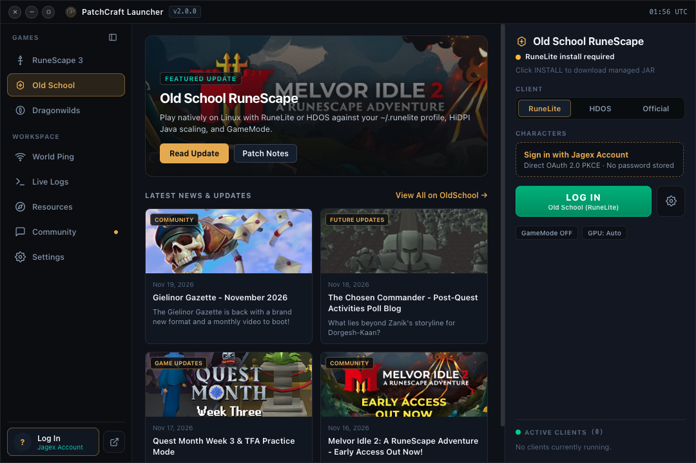

<p align="center">
  
</p>

<h1 align="center">Linux Jagex Launcher — ARM64 (<code>aarch64</code>)</h1>

<p align="center">
  <strong>Dedicated native Linux ARM64 development branch for the Linux Jagex Launcher.</strong><br>
  <em>Looking for stable <code>x86_64</code> desktop or Steam Deck releases? Switch to the <a href="https://github.com/cook0001/Linux-Jagex-Launcher/tree/main"><code>main</code> branch</a>.</em>
</p>

<p align="center">
  <a href="https://github.com/cook0001/Linux-Jagex-Launcher/releases/tag/v0.0.1-arm64"></a>
  <a href="https://github.com/cook0001/Linux-Jagex-Launcher/releases"></a>
  <a href="LICENSE"></a>
</p>

> [!IMPORTANT]
> **Active ARM64 Preview (`v0.0.1-arm64`)**
> ARM64 builds are **prereleases** focused on bringing Linux Jagex Launcher to `aarch64` Linux hardware (Apple Silicon via Asahi Linux, Snapdragon X laptops, Raspberry Pi 5, NVIDIA Jetson / Orin, and ARM64 desktops).
> - **Playable today:** **Old School RuneScape via native ARM64 RuneLite** (plus full Jagex Account OAuth 2.0 PKCE + Cloudflare Turnstile authentication and multi-character switching).
> - **Experimental / Not yet verified playable:** **RuneScape 3 (NXT)**, **HDOS**, **Official OSRS C++ Client**, and **RuneScape: Dragonwilds** currently ship `x86_64`-only upstream binaries. Translation scaffolding via **Box64** and **FEX-Emu** is wired into the launcher for testing, but has **not** yet been verified playable end-to-end on ARM64 hardware.

---

## Current ARM64 Compatibility Matrix

| Feature / Client | Status on ARM64 (`aarch64`) | Notes |
| --- | --- | --- |
| **Launcher UI & Auth** | **Working (Native ARM64)** | Native `aarch64` Electron binary, Direct Jagex OAuth 2.0 PKCE login, Cloudflare Turnstile webview verification, multi-account & multi-character switching. |
| **Old School RuneScape — RuneLite** | **Playable (Native ARM64)** | Detects ARM64 OpenJDK (`11+`, e.g. `/usr/lib/jvm/java-*-openjdk-arm64/bin/java`) and `RuneLite-aarch64.AppImage`. Default selected game & client on ARM64 installs. |
| **RuneScape 3 (NXT)** | **Experimental / Unverified (`x86_64`)** | Upstream NXT client is `x86_64`-only. Launcher includes Box64 / FEX-Emu translation wrapping (`BOX64_LD_LIBRARY_PATH`), `aarch64-linux-gnu` / `:arm64` checks, and `Rs3Doctor` diagnostics, pending end-to-end hardware verification. |
| **HDOS** | **Experimental / Unverified (`x86_64` JNI)** | HDOS extracts `x86_64` native JNI libraries (`x86-jni`) at runtime, which fail under native ARM64 OpenJDK. Translation layer wrapping via an `x86_64` JRE + Box64/FEX-Emu is scaffolded but unverified. |
| **Official OSRS C++ Client** | **Not Supported (`x86_64` Steam/Proton)** | Upstream official C++ client requires `x86_64` Steam + Proton runtime; translation is experimental. |
| **RuneScape: Dragonwilds** | **Not Supported (`x86_64` Only)** | Launches through `x86_64` Steam/Proton with no native Linux ARM64 build. Blocked on ARM64 unless Steam or Box64 / FEX-Emu is present for experimental translated launch attempts. |
| **Auto-Updater** | **Working (ARM64-Filtered)** | Queries GitHub releases and filters specifically for `v*-arm64` prerelease tags and ARM64 assets, never overwriting ARM64 installs with `x86_64` builds. |

<p align="center">
  
</p>

---

## What Has Been Built for ARM64 (`0.0.1-arm64`)

1. **Dedicated ARM64 Packaging & Prerelease Channel (`vX.Y.Z-arm64`)**
   - Publishes native `arm64` (`aarch64`) `.AppImage`, `.deb`, and `.tar.gz` artifacts alongside `SHA256SUMS-arm64.txt` under tagged prereleases so the stable `main` (`x86_64`) `Latest` release remains untouched.
2. **Architecture Detection & Client Badges (`arm64` engine)**
   - Inspects runtime platform architecture (`aarch64` / `arm64`) and reads ELF headers (`0x3e` `x86_64` vs `0xb7` `aarch64`) on detected client binaries.
   - Displays clear compatibility badges (**`ARM64 PLAYABLE`**, **`x86_64 JNI`**, and **`x86_64 ONLY`**) in the UI so you know immediately which clients run natively and which require translation.
3. **Experimental Box64 & FEX-Emu Translation Controls**
   - Automatically detects **`box64`** and **`FEXInterpreter` / `FEXBash`** on your `PATH`.
   - New **Settings → ARM64 & x86_64 Client Compatibility** selector: `auto` (prefers Box64 when present, otherwise FEX-Emu), `box64`, `fex`, or `none` (disabled), plus **Custom Launch Command Wrapper** (`%command%`) in Settings for advanced launch overrides.
4. **ARM64-Aware Java, System Dependencies & Doctor Diagnostics**
   - **`OsrsDoctor`** recognizes ARM64 OpenJDK paths, `aarch64` JVM architecture strings, and `RuneLite-aarch64.AppImage`, while surfacing ARM64 translator status checks.
   - **`Rs3Doctor`** checks ARM64 translator availability (`box64` / `FEXInterpreter`) and **`System`** diagnostics support `aarch64-linux-gnu` shared library paths and Debian `:arm64` `t64` package names.
5. **Architecture-Safe Updater**
   - Ensures ARM64 installations only detect and prompt for `vX.Y.Z-arm64` releases matching `arm64` / `aarch64` asset naming conventions.

---

## Download & Install (`v0.0.1-arm64`)

Download the latest ARM64 prerelease artifacts from the **[`v0.0.1-arm64` Release Page](https://github.com/cook0001/Linux-Jagex-Launcher/releases/tag/v0.0.1-arm64)**:

- `Jagex-Launcher-0.0.1-arm64.AppImage` — Universal ARM64 AppImage
- `jagex-launcher_0.0.1_arm64.deb` — Debian / Ubuntu / Raspberry Pi OS / Armbian (`arm64`)
- `linux-jagex-launcher-0.0.1-arm64.tar.gz` — Portable ARM64 tarball (Fedora Asahi Remix, Arch Linux ARM, Manjaro ARM, NixOS, etc.)
- `SHA256SUMS-arm64.txt` — Checksums for all ARM64 release assets

### Verify Checksums First

```bash
sha256sum -c SHA256SUMS-arm64.txt --ignore-missing
```

### AppImage (Any `aarch64` Linux Distro)

```bash
chmod +x Jagex-Launcher-0.0.1-arm64.AppImage
./Jagex-Launcher-0.0.1-arm64.AppImage
```

> **Tip:** If your distro restricts FUSE2/AppImage user namespaces, run with `--appimage-extract-and-run` or use `--no-sandbox` if needed.

### Debian / Ubuntu / Raspberry Pi OS (`arm64`)

```bash
sudo apt install ./jagex-launcher_0.0.1_arm64.deb
```

### Portable Tarball (Fedora Asahi / Arch Linux ARM / Custom)

```bash
tar -xzf linux-jagex-launcher-0.0.1-arm64.tar.gz
cd linux-jagex-launcher-0.0.1-arm64
./jagex-launcher
```

### Native ARM64 OpenJDK & RuneLite Setup (Recommended for OSRS)

For Old School RuneScape, install ARM64 OpenJDK (11, 17, or 21) and download the official `aarch64` RuneLite AppImage, or let the launcher detect/manage it in **Settings / OSRS Doctor**:

```bash
# Debian / Ubuntu / Raspberry Pi OS (arm64)
sudo apt install openjdk-17-jre

# Fedora / Asahi Remix (aarch64)
sudo dnf install java-17-openjdk
```

### Snap (Experimental ARM64 Packaging)

> [!NOTE]
> ARM64 Snap packages are **not** currently published on the Snap Store for this prerelease. Upstream Snap configuration retains standard plug commands when building or testing Snaps locally:
>
> ```bash
> sudo snap install linux-jagex-launcher
> sudo snap connect linux-jagex-launcher:joystick
> ```

---

## Testing Experimental `x86_64` Clients on ARM64

If you are helping test **RuneScape 3 (NXT)** or **HDOS** on an `aarch64` machine:

1. Install **[Box64](https://github.com/ptitSeb/box64)** and/or **[FEX-Emu](https://fex-emu.com/)** (`FEXInterpreter` / `FEXBash`) along with the required `x86_64` rootfs / multi-arch libraries (`libcurl`, `libssl`, `libstdc++`, Vulkan/OpenGL drivers for your GPU such as Panfrost, Freedreno/Turnip, Apple Asahi Mesa, or VideoCore).
2. Open **Settings → ARM64 & x86_64 Client Compatibility** and choose **`auto`** (prefers Box64), **`box64`**, or **`fex`**.
3. Run **Doctor** inside the RS3 or OSRS view to inspect detected binary ELF architectures, OpenJDK paths, and active translator availability.
4. For custom wrappers (e.g., `box64 %command%`, FEX rootfs prefixes, or Gallium/Mesa overrides), set a **Custom Launch Command Wrapper** in Settings.

Please share hardware + distro + kernel page size (`getconf PAGESIZE`) + Doctor output in **[GitHub Issues](https://github.com/cook0001/Linux-Jagex-Launcher/issues)** so we can validate and promote clients from **Experimental** to **Playable** in the compatibility matrix!

---

## ARM64 Development Roadmap

- [x] `aarch64` cross-compilation and native `.AppImage`, `.deb`, and `.tar.gz` release pipeline (`v0.0.1-arm64`)
- [x] Architecture-filtered GitHub prerelease auto-updater (`v*-arm64`)
- [x] Native ARM64 RuneLite + ARM64 OpenJDK detection and OSRS Doctor checks
- [x] Box64 / FEX-Emu detection, Settings preference, and UI architecture compatibility badges
- [ ] End-to-end hardware verification for **RuneScape 3 (NXT)** under Box64 and FEX-Emu (4K & 16K kernel pages)
- [ ] Documented **HDOS** `x86_64` JRE + translator launch workflow
- [ ] Optional `.rpm`, `.pacman`, and Snap Store ARM64 channel releases once client translation targets stabilize

---

## Security, Privacy & License

- **License:** Proprietary — All rights reserved. See [LICENSE](LICENSE) for full terms.
- **Privacy:** Credentials stay local inside the official Jagex OAuth / Electron flow; zero telemetry is collected. See [PRIVACY.md](PRIVACY.md).
- **Security:** See [SECURITY.md](SECURITY.md) for checksum verification and vulnerability reporting.
- **Changelog:** Track ARM64 release milestones in [CHANGELOG.md](CHANGELOG.md).

---

*Not affiliated with or endorsed by Jagex Ltd. RuneScape, Old School RuneScape, Jagex, and Dragonwilds are trademarks of Jagex Ltd.*
